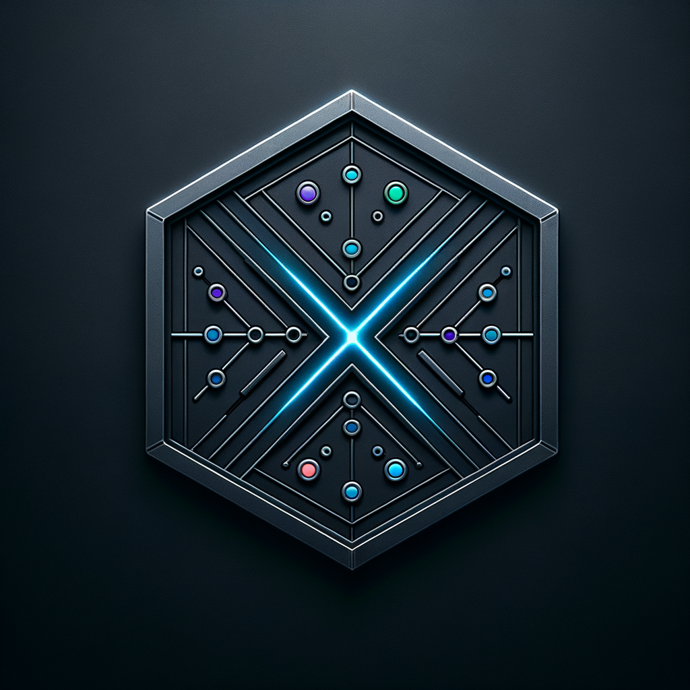
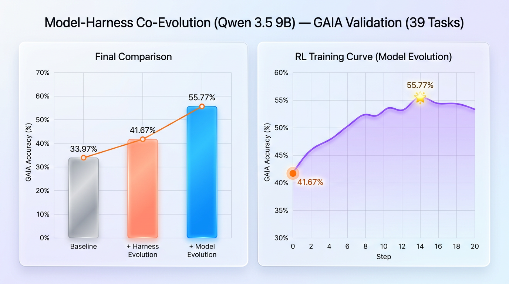

<table align="center" border="0" cellspacing="0" cellpadding="0"><tr><td align="center" valign="middle">

</td><td align="left" valign="middle">
<picture>
  <source media="(prefers-color-scheme: dark)" srcset="docs/assets/harnessx_wordmark_dark.png"/>
  <source media="(prefers-color-scheme: light)" srcset="docs/assets/harnessx_wordmark.png"/>
  
</picture>
<br/>
<b>Compose. &nbsp; Adapt. &nbsp; Evolve.</b>
</td></tr></table>

<p align="center">
  <strong>Compose the Harness, define the Agent.<br/>
  From zero-code to full customization — one core, X entry points.</strong>
</p>

<p align="center">
  <a href="LICENSE"></a>
  
  
  
  <a href="https://raw.githack.com/Darwin-Agent/HarnessX/gh-pages/index.html"></a>
</p>

<p align="center">
  <a href="https://raw.githack.com/Darwin-Agent/HarnessX/gh-pages/index.html">Homepage</a> •
  <a href="#overview">Overview</a> •
  <a href="#architecture">Architecture</a> •
  <a href="#quick-start">Quick Start</a> •
  <a href="#benchmarks">Benchmarks</a> •
  <a href="#roadmap">Roadmap</a> •
  <a href="README_zh.md">中文文档</a>
</p>

---

<a id="overview"></a>
## 🔭 Overview


> **The harness — not just the model — determines agent performance.** The same base model produces dramatically different results depending on how context is managed, how tools are orchestrated, how errors are recovered, and how evaluation signals feed back.

HarnessX is a **harness foundry**: forge any number of agent harnesses from reusable processors and bundles, pair each with any model, and evolve them through training — all without rewriting the agent.

Most frameworks solved model swapping. **Behavior swapping** remains expensive — switching from a coding agent to a research agent, adding memory or guardrails, means rewriting the agent.

HarnessX solves this with one clean separation:

```python
agent = model.agentic(harness)
```

- `ModelConfig` — provider routing, fallback, per-role model assignment
- `HarnessConfig` — the full behavior pipeline (tools, memory, processors, trace, sandbox)

The **X** in Harness**X** stands for e**X**tensible Behavior Composition — compose, adapt, and evolve harnesses without rewriting the agent:

🧩 **Compose** — 9-dimension behavior pipeline; any behavior = Processor, combine with `|` operator.

⚙️ **Adapt** — Harness observes performance and auto-searches optimal harness configurations.

🚀 **Evolve** — every run produces reward-annotated trajectories that feed SFT / RL training.

---

<a id="architecture"></a>
## 🏗️ Architecture

<p align="center">
  
</p>

→ See **[docs/architecture.md](docs/architecture.md)** for the full 9-dimension behavior pipeline, processor hook points, and composition API.

---

<a id="quick-start"></a>

## 🚀 Quick Start

<details>
<summary>Click to expand</summary>

### Install

**One-click install** (interactive — asks before installing uv, Node.js, and optional IM Gateway):

```bash
curl -sSf https://raw.githubusercontent.com/Darwin-Agent/HarnessX/main/scripts/install.sh | bash
```

**Non-interactive — install everything without prompts:**

```bash
curl -sSf https://raw.githubusercontent.com/Darwin-Agent/HarnessX/main/scripts/install.sh | bash -s -- --all
```

Both commands install uv, Python 3.12, harnessx, and (with Node.js available) the Harness Lab frontend.
After installation, reload your shell or run `source ~/.bashrc` (or `~/.zshrc` on macOS).

<details>
<summary>Manual install with <a href="https://docs.astral.sh/uv/">uv</a></summary>

```bash
uv python install 3.12
uv venv --python 3.12 .venv
source .venv/bin/activate
uv pip install -e .
# Build frontend (required for hx lab)
cd frontend && npm install && npm run build && cd ..
```

</details>

### CLI

```bash
export ANTHROPIC_API_KEY="<your-api-key>"

hx "Research 2026 AI agent trends and write a structured report"
hx -p "Write a Python fizzbuzz"     # non-interactive, print and exit
hx -c path/to/config.yaml           # load a YAML config
hx --resume <run_id>                # resume a previous session
hx lab                              # open the Lab UI at localhost:8000
```

### IM Gateway

Connect your agent to Feishu, Telegram, Slack, Discord, or DingTalk with a single service.
The gateway ships with a built-in React console for managing channels, sessions, and workspaces.

```bash
hx-gateway start   # start the gateway (configured in ~/.harnessx/gateway.yaml)
```

→ See **[gateway/README.md](gateway/README.md)** for setup, channel configuration, and architecture.

### Python SDK

<details>
<summary>Minimal runnable example</summary>

```python
import asyncio
from harnessx import BaseTask, HarnessConfig
from harnessx.core.model_config import ModelConfig
from harnessx.providers.anthropic_provider import AnthropicProvider

async def main():
    model = ModelConfig(main=AnthropicProvider("claude-sonnet-4-6"))
    harness = model.agentic(HarnessConfig())
    result = await harness.run(BaseTask(description="What is 2 + 2?"))
    print(result.final_output)

asyncio.run(main())
```

</details>

</details>

---

<a id="benchmarks"></a>
## 📊 Benchmarks

HarnessX supports harness search, distributed model training, and alternating Harness + Model co-evolution. The experiments below cover harness search and sequential harness-then-model optimization. See the [evolution guide](docs/guide/evolution.md) for the available workflows and [`benchmarks/README.md`](benchmarks/README.md) for benchmark adapters.

### Harness Evolution (Qwen 3.5 9B)

Starting from a default harness (R0, 33%), the meta-harness discovers better configurations round by round — reaching **47%** by R3, a **+14pp gain** with zero model changes. → Reproduce: [`recipe/gaia_evolver/`](recipe/gaia_evolver/)

<p align="center">
  
</p>

### Harness Evolution (GPT-5)

The same approach scales to frontier models. Overall GAIA accuracy rises from 62% to **84%** after evolution, with gains across all five domains. → Reproduce: [`recipe/gaia_evolver/`](recipe/gaia_evolver/)

<p align="center">
  
</p>

### Sequential Evolution: Harness First, Then Model (Qwen 3.5 9B)

In the two-stage workflow, Harness evolution lifts the baseline from 33.97% to 41.67%; subsequent model optimization pushes it further to **55.77%** — a **+64% relative improvement**, all on a 9B model. → Run [`recipe/gaia_evolver/`](recipe/gaia_evolver/) followed by [`recipe/verl_harnessX/`](recipe/verl_harnessX/).

<p align="center">
  
</p>

### Alternating Harness + Model Co-Evolution

Each round runs normal agent exploration with the current Harness population and saves its trajectories. After exploration, MetaAgent performs AEGIS Harness evolution from those trajectories; cross-Harness model evolution then updates the model offline from the saved buffer. The single exploration rollout is ordinary agent sampling; model training itself does not generate responses. The evolved Harness state and updated model carry forward together.

Start with `python -m recipe.coevolution.run --backend verl`. The [co-evolution runbook](recipe/coevolution/README.md) covers environment setup, data formats, meta-model configuration, checkpoint export, and resume.

---

<a id="structure"></a>
## 📁 Project Structure

```
HarnessX/
├── harnessx/                  # 🧠 Core framework
│   ├── core/                  #    Harness, Builder, RunLoop, State, Events, Trajectory
│   ├── processors/            #    7 categories × multiple processors
│   │   ├── context/           #    📝 System prompt, history, user wrapper
│   │   ├── control/           #    🛡️ 13 safety & reliability processors
│   │   ├── evaluation/        #    📊 LLM judge, PRM, self-verify
│   │   ├── memory/            #    🧠 Extraction, retrieval, 5 strategies
│   │   ├── multi_model/       #    🔗 Model routing
│   │   ├── observability/     #    🔭 OTel, checkpoints, metrics
│   │   └── tools/             #    🔧 Skill loader, schema adapter, filters
│   ├── providers/             # 🔌 6 model backends + agentic mixin
│   ├── plugins/               # 🧩 Plugin base, discovery, builtins, dimensions
│   │   └── dimensions/
│   │       └── light_memory/  # 🧠 Light-Memory (self-developed)
│   ├── tools/                 # ⚒️ Tool registry, builtins
│   ├── sandbox/               # 📦 Local, Docker, E2B
│   ├── tracing/               # 📡 Journal, OTel, null tracer
│   ├── rl/                    # 🧬 RLConfigSpec, TaskBuilder
│   ├── bundles/               # 📦 Pre-composed capability bundles
│   ├── api/                   # 🌐 FastAPI + SSE for Lab UI
│   └── cli.py                 # ⌨️ CLI entry point (hx)
├── benchmarks/                # 📊 5 integrated + 2 ongoing benchmarks
├── recipe/                    # 🧪 Co-evolution, veRL, Slime, benchmark evolution
├── examples/                  # 📖 coding / research / assistant / custom_processor
├── extensions/                # 🔌 Skills (docx, pdf, pptx, xlsx)
├── frontend/                  # 🖥️ Lab UI (React + TypeScript + Tailwind)
└── tests/                     # ✅ Unit, integration, E2E
```

---

<a id="roadmap"></a>
## 🗺️ Roadmap

> For detailed design notes and motivation behind planned items, see [ROADMAP](docs/ROADMAP.md).

| Phase | Focus | Status |
|:-----:|-------|:------:|
| **1** | Core: 9-dimension behavior pipeline, 13 processors, multi-provider, SFT/RL bridge, 5 benchmarks, Lab UI |  |
| **2** | Meta-opt: Bayesian Optimization, Meta-Harness, auto config search |  |
| **3** | Self-evolution: alternating Harness + Model training; HarnessHUB community marketplace |  |
| **4** | Memory: Light-Memory, LoCoMo; multimodal backends and third-party memory adapters |  |

### Available Now

- ✅ **[Light-Memory](docs/feats/light-memory.md)** — file-based memory with time-decay, daily compression, git versioning (`harnessx/plugins/dimensions/light_memory/`)
- ✅ **Slime RL recipe** — SGLang rollout adapter + token annotation + GRPO training pipeline (`recipe/slime/`)
- ✅ **MetaHarness** — agent observes its own trajectories and proposes harness config changes; observer harness + meta-agent + sandboxed promotion loop
- ✅ **[LoCoMo benchmark](benchmarks/locomo/README.md)** — multi-session conversational memory evaluation, configurable session compression, QA scoring, and LLM-as-Judge
- ✅ **[Harness + Model Co-Evolution](recipe/coevolution/README.md)** — alternating MetaAgent harness search and cross-harness GRPO; checkpoint export and round-by-round resume

### Planned

- ◻️ **Bayesian Optimization** — surrogate model search over the ~10^6-configuration harness space
- ◻️ **HarnessHUB** — community platform to publish, version, and pull `HarnessConfig` bundles (`hx pull coding-agent@v1.2`; Lab UI panel; private registries)
- ◻️ **Multimodal Memory** — CLIP-based image/video memory backend via the plugin system
- ◻️ **Harness Memory Evolution** — memory-specialized population search and a deployment-to-training data flywheel

### Available Integrations *(opt-in, live in `recipe/`)*

- ✅ **[veRL](recipe/verl/README.md)** — HarnessX rollouts and distributed GRPO training

### Planned Integrations

- ◻️ **[MemPalace](https://github.com/mem-palace/mem-palace)** — structured episodic memory backend
- ◻️ **[SuperMemory](https://supermemory.ai)** — cloud-backed semantic memory via the plugin system
- ◻️ **[OpenVKing](https://github.com/openvking)** — vector-knowledge-graph memory for entity-rich domains
- ◻️ **Memory quality metrics** — retrieval precision / recall surfaced through HarnessJournal
- ◻️ **Data synthesis pipeline** — controlled SFT / preference-dataset generation with diversity constraints

---

## 🤝 Contributing

HarnessX is **fully open-source** under the MIT License. Contributions are welcome for:

- 🧩 **New processors** — behavior modules for unexplored dimensions
- 🧠 **New memory backends** — via the plugin system
- 📊 **New benchmark adapters** — `benchmarks/` pattern
- 🧪 **RL training recipes** — `recipe/`
- 🖥️ **Lab UI improvements**

Please read [CONTRIBUTING.md](CONTRIBUTING.md) first.

---

```bibtex
@software{harnessx2026,
  title   = {HarnessX: A Composable, Self-Evolving Agent Harness Foundry},
  author  = {Darwin Agent Team},
  year    = {2026},
  url     = {https://github.com/Darwin-Agent/HarnessX},
  license = {MIT},
}
```

---

<div align="center">
  <strong>HARNESS</strong><strong>X</strong> — <em>Compose. Adapt. Evolve.</em>
  <br/>
  <sub>Built with care by the <strong>Darwin Agent Team</strong></sub>
</div>
